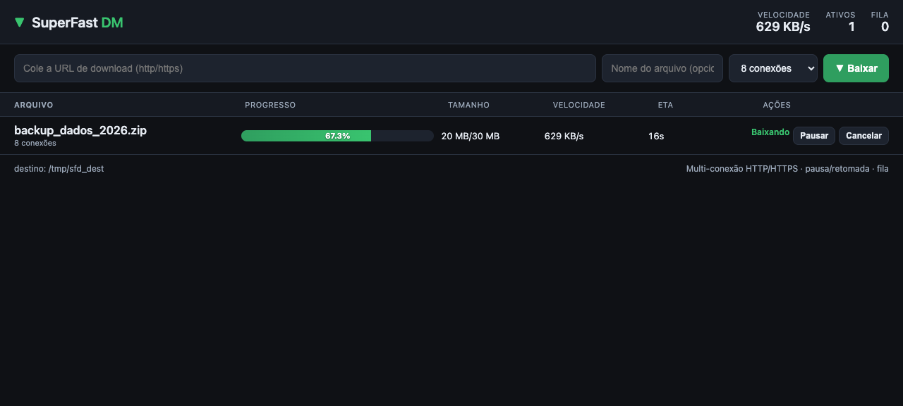

# SuperFast DM

Gerenciador de downloads de alta velocidade com **multi-conexão**, **pausa/retomada**, **fila** e **histórico persistente** — com interface web local e extensão de navegador.

Feito em **Python puro (stdlib)**: zero dependências, roda em macOS e Windows, leve e fácil de inspecionar.



## Por que
SuperFast DM é um gerenciador de downloads **standalone**. Compete com os managers mainstream (Internet Download Manager, JDownloader, Free Download Manager, entre outros) — mas é minimalista, sem dependências e fácil de estender/automatizar.

## Recursos
- **Multi-conexão HTTP/HTTPS**: divide o arquivo em segmentos (até 32) e baixa em paralelo via `Range`.
- **Pausa e retomada**: congela a qualquer momento e retoma dos offsets persistidos — inclusive **após reiniciar o app/servidor**.
- **Fila**: N downloads simultâneos configuráveis; os demais esperam.
- **Histórico e configurações**: SQLite, sobrevive a restart.
- **Tamanho desconhecido (chunked)**: baixa arquivos sem `Content-Length` até o EOF.
- **Velocidade + ETA + progresso** ao vivo.
- **UI web local**: tema escuro, polling leve, sem framework.
- **Extensão de navegador** (Chrome/Edge/Firefox): botão "SFD" sobre links.
- **Zero dependências**: apenas a biblioteca padrão do Python 3.

## Como funciona (resumo)
1. Um **servidor local** (stdlib) sobe em `http://127.0.0.1:7860` — serve a UI e a API.
2. O **motor** usa 1 supervisor por tarefa e 1 thread por segmento; a escrita vai para offsets únicos de um arquivo pré-alocado (com lock), o que permite baixar em paralelo sem corromper.
3. O estado (segmentos/offsets, progresso, velocidade) é persistido em **SQLite**; ao reiniciar, o app **retoma** de onde parou.
4. O **navegador** (extensão) detecta links e envia a URL para o servidor via `POST /api/add`.

Detalhes em [ARCHITECTURE.md](ARCHITECTURE.md).

## Instalação

### macOS
```
cd installer/mac
./build-app.sh            # gera "SuperFast DM.app"
./build-app.sh --dmg      # (opcional) gera também "SuperFastDM.dmg"
```
Abra o app gerado — ele inicia o servidor e abre o navegador.

### Windows
1. Instale o [Inno Setup](https://jrsoftware.org/isinfo.php).
2. Compile `installer/windows/superfastdm.iss` (File → Compile).
3. Gera `SuperFastDM Setup.exe`.

Ou modo **portável** (sem instalador): dê dois cliques em `installer/windows/SuperFastDM.bat` (ou rode `python app\server.py`).

### A partir do código (qualquer sistema)
```
python app/server.py
# abre http://127.0.0.1:7860
```

## Uso
- Abra `http://127.0.0.1:7860`.
- Cole a URL de um download (http/https) e clique em **Baixar**.
- Ou instale a extensão e clique no botão **SFD** que aparece sobre links.
- Pause, retome, cancele ou remova itens da lista.

## Configuração (variáveis de ambiente)
| Variável | Padrão | Descrição |
|---|---|---|
| `SFD_PORT` | `7860` | Porta do servidor |
| `SFD_HOST` | `127.0.0.1` | Bind (mantenha em loopback) |
| `SFD_DEST` | `~/Downloads/superfast-dm` | Pasta de destino dos arquivos |
| `SFD_DATA` | `~/.superfast-dm` | Pasta de dados (banco SQLite) |
| `SFD_MAX_PARALLEL` | `3` | Downloads simultâneos |
| `SFD_OPEN` | `0` | `1` = abrir o navegador ao subir |

## API (resumo)
| Método | Rota | Descrição |
|---|---|---|
| `GET` | `/api/tasks` | Lista os downloads |
| `POST` | `/api/add` | `{url, filename?, connections?}` → `{id}` |
| `POST` | `/api/task/<id>/pause` | Pausa |
| `POST` | `/api/task/<id>/resume` | Retoma |
| `POST` | `/api/task/<id>/cancel` | Cancela |
| `POST` | `/api/task/<id>/remove` | Remove (cancela + limpa da lista) |
| `GET` | `/api/config` | Configuração atual |
| `GET` | `/health` | Health check |

## Extensão de navegador
Pasta `app/extension/` (MV3). Em `chrome://extensions` → *Modo do desenvolvedor* → *Carregar sem compactação* → selecione a pasta. O botão "SFD" aparece no hover sobre links e envia a URL para o servidor.

## Estrutura
```
app/            # servidor + motor + UI + extensão (stdlib)
  server.py     # servidor local (UI + API)
  engine.py     # motor multi-conexão (segmentos, pausa/retomada, retomada pós-restart)
  db.py         # camada SQLite (histórico/segmentos/config)
  static/       # UI web (index.html, app.js, style.css)
  extension/    # extensão Chrome/Edge/Firefox (MV3)
installer/      # instaladores (macOS .app/.dmg, Windows Inno Setup)
ARCHITECTURE.md # detalhes de arquitetura
CHANGELOG.md    # histórico de versões
```

## Licença
MIT — veja [LICENSE](LICENSE).
